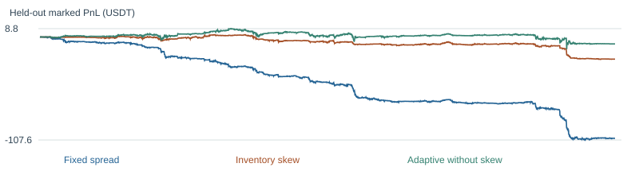
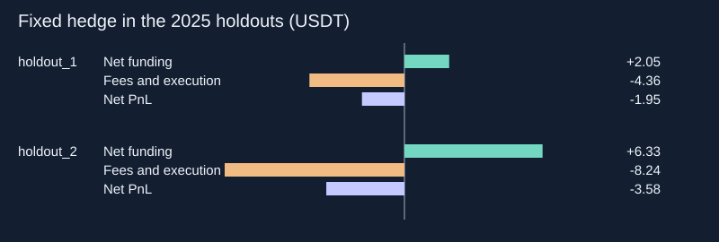
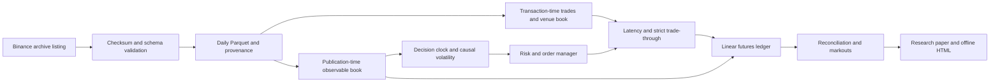

# Quantitative Trading Research

**[Open the interactive funding-carry dashboard](https://hiten41.github.io/quantitative-trading-research/)** · [Funding-carry paper](reports/funding-carry/final/research.md) · [Market-making paper](reports/research.md)

Two historical ETHUSDT experiments examine whether trading revenue survives execution costs and risk constraints. The market-making simulator tests passive quotes against trade and order-book events. The funding-carry simulator pairs spot ETH with a short perpetual and tracks each wallet separately. All results are simulated and denominated in USDT.

- **Market making.** The inventory-skewed maker lost **23.11 USDT** on its three-day holdout. A later anchored-quote variant earned **21.21 USDT** in development, then lost **2.08** and **3.44 USDT** on two separate five-day evaluations after funding and estimated close costs. [Follow-up experiment](reports/adaptation/findings.md)
- **Funding carry.** The original depth-based fixed hedge earned **32.16** and **87.71 USDT** in two positive-funding quarters. Under the expanded minute-based model, the fixed hedge lost **1.95** and **3.58 USDT** in the March and October 2025 holdouts. Both adaptive carry rules stayed in cash in those months. [Benchmark reconciliation](reports/funding-carry/audit.md) · [All scenario results](reports/funding-carry/final/metrics.csv)

## Event-driven market making

**Neither strategy earned a positive return on the three-day holdout.** Starting from 10,000 USDT, fixed-spread quoting lost **105.84 USDT** and inventory-skewed adaptive quoting lost **23.11 USDT**. Removing skew while retaining the adaptive widths reduced the loss to **7.17 USDT**. The skewed policy held less inventory on average, but its incremental PnL versus the no-skew policy was **−15.94 USDT**.

[Interactive offline report](reports/index.html) · [Research paper](reports/research.md) · [Data-quality manifest](reports/quality.json) · [Evaluation metrics](reports/evaluation.json) · [Fill audit](reports/audit.json)



## Delta-neutral funding carry

Buying ETH spot and shorting an equal amount of the ETHUSDT perpetual produced positive historical net PnL in both quarters tested. The strategy earned **32.16 USDT** from October 1, 2023 to January 1, 2024 and **87.71 USDT** from January 1 to April 1, 2024. Each replay began with 10,000 USDT and closed both positions. All 549 funding payments favored the short. Without positive funding, the same executions lost money in both periods. [Results and assumptions](reports/funding-carry/findings.md) · [Hourly PnL](reports/funding-carry/equity.html) · [Fixed protocol](configs/funding_carry.json)

Run `python -m fundingcarry` in the installed research environment to verify the data hashes and reproduce both periods, fee and slippage stresses, and the funding-removal test.

#### Expanded funding-carry study

The expanded fixed hedge earned **32.2127 and 89.2547 USDT** on the two benchmark calendars. The original benchmark command above reproduces **32.1580 and 87.7125 USDT**. Both use the same 0.5 ETH hedge and the same 276 and 273 funding settlements. Their execution assumptions explain most of the difference. [Original fills and funding](reports/funding-carry/results.json) · [Expanded fills](reports/funding-carry/final/fills.csv.gz)

- The original replay prices simulated orders against recorded five-level spot and futures books, 250 ms and 1,250 ms after each decision. It schedules the exit at 11:55 UTC. The opening spot fee is paid in ETH, so the replay buys enough to cover the fee and writes off the sub-lot remainder.
- The expanded replay prices each leg from its own market’s one-minute trades, adds a modeled spread and slippage, rounds to the tick, and charges fees in quote currency. In both quarters it scheduled the exit at 11:40 UTC and booked the spot sale and futures cover at 11:41 and 11:42. For the 89 missing settlement marks in the first quarter, using the prior minute’s close in place of the adverse settlement-minute price added just 0.0014 USDT. The new margin model triggered no transfers or liquidations in either fixed-policy base case.

The fixed hedge lost 1.95 USDT in March 2025 and 3.58 USDT in October 2025. The funding-aware and risk-controlled policies stayed in cash in both frozen holdouts. September 2022 contained a 25-settlement negative streak. The fixed hedge paid 12.59 USDT net funding in the selected replay and lost 13.19 USDT after price moves and costs. The regression audit traced 89 missing settlement marks to 4.60 USDT of estimated receipts. [Offline dashboard with 12 figures](reports/funding-carry/final/index.html) · [Research paper](reports/funding-carry/final/research.md) · [Independent baseline audit](reports/funding-carry/audit.md)



The experiment tests whether signed funding can cover basis changes, legging costs and four taker transactions. The short receives positive funding and pays negative funding on its marked notional. The discovery utility scans checksum-verified Binance monthly funding archives. For expanded replays the engine uses distinct spot and perpetual one-minute side-volume price proxies, prior published rates, separate cash wallets, delayed collateral transfers and minute-high liquidation checks. Minute-average trade prices cannot establish the bid, ask or available size when a leg would have executed. The reported PnL therefore depends on simulated fills. The liquidation model tests the minute’s high using assumed 10% initial margin, 1% maintenance margin and a 0.5% penalty. Historical account tiers, the sequence of prices within the minute and actual liquidation fills could not be verified. The resulting liquidation counts describe stress scenarios. One-at-a-time cost, funding, execution and collateral stresses include matched 1x through 5x collateral scenarios. [Sources and hashes](reports/funding-carry/final/sources.json) · [Frozen rules](configs/carry_study.json) · [Per-window and scenario metrics](reports/funding-carry/final/metrics.csv)

The study modules in `src/fundingcarry/` handle discovery and price provenance (`study_data.py`), policies and event accounting (`study_engine.py`), the original cash reconciliation (`study_audit.py`) and publication (`study_report.py`). From the repository root, with Python 3.13 and a virtual environment activated, run

```powershell
python -m pip install -r configs/research-requirements.txt
python -m pip install -e .
python scripts/reproduce_funding_carry.py
```

A measured cached run took about 45 seconds on the research machine. The hashed inputs occupied 168.0 MiB. Initial downloads need additional time and temporary storage. A complete verified cache supports a disconnected rerun. The dashboard embeds Plotly and its data. Each window has a shareable URL, and the drawdown chart includes the exact minute of each policy’s maximum drawdown. The [formatted paper](https://hiten41.github.io/quantitative-trading-research/reports/funding-carry/final/research.html), [data explorer](https://hiten41.github.io/quantitative-trading-research/reports/funding-carry/final/data.html), and [benchmark audit](https://hiten41.github.io/quantitative-trading-research/reports/funding-carry/audit.html) open offline alongside the dashboard. The reproduction command checks the original results, the input lock, signed settlements, decision cutoffs and wallet identities before publishing. [Machine-readable run details](reports/funding-carry/final/study.json)

## Market-making methodology and reproduction

### Follow-up experiment with anchored quotes

The follow-up tested twelve candidate configurations on the original five days and selected a one-hour reference-price average with 30 bp entry bands. The two evaluation windows each started flat and used the locked parameters. Funding, terminal close costs, and adverse fee and participation scenarios are reported separately. [Follow-up results](reports/adaptation/findings.md) · [Held-out PnL curves](reports/adaptation/equity.html) · [Locked selection](reports/adaptation/selection.json)

After installing the package and preparing the original dataset, run the following commands from the repository root.

```powershell
python scripts/adapt.py select
python -m mmbacktest download --symbol ETHUSDT --start 2023-09-07 --end 2023-09-11 --data data/followup --reference reports/adaptation/quality.json
python scripts/adapt.py evaluate
python -m mmbacktest download --symbol ETHUSDT --start 2023-09-13 --end 2023-09-17 --data data/confirmation --reference reports/adaptation/confirmation/quality.json
python scripts/adapt.py confirm
python scripts/adaptation_report.py
```

For a single-strategy replay using a dataset containing September 2–11 in one data root, use `python -m mmbacktest backtest --strategy anchored_maker --config configs/anchored.yaml --data YOUR_DATA_ROOT`. The comparison above uses independently validated archives in separate roots.

### The experiment

Can a passive maker earn spread after paying fees and carrying inventory through adverse price moves? This project replays every individual trade in a five-day Binance USD-M ETHUSDT perpetual sample alongside its historical best bid, ask and displayed sizes. Two days (September 2–3, 2023 UTC) form the calibration period. The following three days (September 4–6) form the holdout. Each phase starts flat. Positions carry overnight within each phase. All fees below use a hypothetical **1 bp per executed side**. The funding records returned empty settlement marks, so all policies exclude funding.

| Held-out metric | Fixed spread | Adaptive + skew | Adaptive without skew |
| --- | ---: | ---: | ---: |
| Gross PnL, USDT | −51.41 | −16.80 | −1.81 |
| Fees, USDT | 54.42 | 6.31 | 5.36 |
| Net PnL, USDT | −105.84 | −23.11 | −7.17 |
| Fills, including partial executions | 16,277 | 1,586 | 1,281 |
| Submitted orders receiving a fill | 10.54% | 1.12% | 1.01% |
| Mean absolute inventory, ETH | 0.275 | 0.196 | 0.244 |
| Maximum drawdown, USDT | 107.87 | 25.88 | 30.53 |
| Immediate spread capture, USDT | 20.02 | 6.56 | 6.05 |
| Net PnL / RMS inventory, USDT per ETH | −335.08 | −94.51 | −25.02 |

The standalone HTML contains the fills, quote samples, inventory paths, drawdowns, daily PnL, horizon markouts and sensitivity heatmap. Open the downloaded file in a browser for interactive charts. The paper also compares returns across daily price ranges, reports side-specific markouts and gives a paired six-hour block uncertainty estimate. [Full results](reports/research.md)

### Install and reproduce

Use Python 3.11+ and run from the repository root. The reference environment is CPython 3.13.4 on Windows. These PowerShell commands use the pinned research dependencies. On macOS or Linux, activate with `source .venv/bin/activate`.

```powershell
python -m venv .venv
.\.venv\Scripts\Activate.ps1
python -m pip install -c configs/research-requirements.txt -e ".[dev,report]"
python -m pytest -q
python -m ruff check src tests scripts
python -m mypy
python scripts/reproduce.py
```

The reproduction script verifies the archived ZIPs against the frozen study, regenerates Parquet as needed, replays both phases, runs the full sensitivity grid, exports the report, and audits the recorded exchange trade IDs and ledger. It prints a content-derived run ID. The following individual commands expose the same pipeline. Use the ID printed by `compare` if dependencies, normalized bytes, source code, or configuration differ.

```powershell
python -m mmbacktest data-check
python -m mmbacktest download --symbol ETHUSDT --start 2023-09-02 --end 2023-09-06 --reference reports/quality.json
python -m mmbacktest backtest --config configs/default.yaml --strategy fixed
$comparison = python -m mmbacktest compare --config configs/default.yaml
$runId = ($comparison | Select-String '^Run ID: (.+)$').Matches[0].Groups[1].Value
python -m mmbacktest report --run-id $runId
python scripts/verify_run.py --run-id $runId
python scripts/profile_replay.py
```

Omit `--reference` to fetch current contract metadata and historical funding from Binance for a new experiment. An independent run can use `--runs PATH`; the data commands accept `--data PATH`. For a single-strategy report, use its own run ID and an output directory such as `--output reports/single`. Installing only the base package supports discovery, download, backtest and compare. The `report` extra supplies Plotly. The test suite runs offline after dependency installation.

### Data and chronology

Discovery queries actual S3 listings for both daily file types before downloading. This study used **5,448,909 individual prints and 24,325,079 L1 updates**. The public USD-M contract snapshot identifies ETH as base and USDT as quote and collateral. It supplies the tick (0.01 USDT), size step (0.001 ETH) and modeled order filters. Historical filter revisions remain a limitation. [Binance archive](https://data.binance.vision/) · [Dataset documentation](https://github.com/binance/binance-public-data) · [Retrieved file and contract metadata](reports/quality.json)

The downloader uses bounded parallelism, timeouts, retries with backoff, size checks, SHA-256 sidecars and atomic publication. Normalization streams CSV batches from ZIP to Parquet. The pipeline rejects malformed fields, nonpositive size or price, locked/crossed books, reversed clocks, duplicate IDs, unexplained trade-ID gaps, absent days and gaps longer than 120 seconds including day edges. An inactivity threshold can detect gross outages but cannot prove capture completeness.

Equal timestamps are common. The public data contained 121 trade-ID jumps. Each jump was checked against an independent sequence of aggregate prints. An intra-aggregate gap requires the surrounding raw trades to account for the entire aggregate quantity. Between aggregates the bordering IDs must match exactly. The manifest reports timestamp ties, stale joins, coverage, source names, per-file hashes and event-rate percentiles. Aggregate trades supply corroboration only.



### Quotes and execution

The fixed maker quotes `mid ± mid × spread_bps / 20000`. The adaptive maker uses `r = mid − γ q v H`, where signed inventory `q` is in ETH, `v` is realized price variance per second, `H` is seconds and `γ` is inverse USDT. The estimator sums squared trailing log-mid returns on the refresh grid, divides by elapsed seconds, and converts to price variance using current mid squared. A stale observation resets the window.

Adaptive half-width equals `mid × (spread_bps/2 + max(fee_bps, 0)) / 10000 + a√(vH) + γ Q v H/2` for nominal quantity `Q`. The ablation uses the same half-width centered on mid. These parameters describe an A–S-inspired quoting rule. They were specified before the holdout comparison. [Default configuration](configs/default.yaml)

- A strategy sees published L1 state. The venue checks post-only activation on its transaction clock. On timestamp ties, funding and expiry precede prints. Prints precede acknowledgements and decisions, and fills use the strictly earlier published mid. Inventory updates immediately after each simulated fill. Additional fill-notification latency is unmodeled.
- Quote decisions occur every 5 seconds. New orders take 50 ms to activate and cancellations take 80 ms. A pending cancellation can still fill. Each side waits for acknowledgement and the next decision before replacing an order. Orders expire 15 seconds after activation. The simulator rejects marketable submissions and orders crossing another active own order.
- Default orders are 0.1 ETH with a 0.5 ETH hard position cap. Bid prices round down, asks round up and quantities round down. Position headroom is reserved in whole lots. Stale books suppress fills and quoting.
- A sell-initiated trade must print below a resting bid; a buy-initiated trade must print above a resting ask. Each hypothetical policy can consume at most 10% of each eligible print, rounded down to lots, at its resting price. One outstanding order per side prevents allocating the same print twice. Configure `fill_model: queue` to allow at-price fills after consuming the visible queue at activation. Unknown queue depth receives no at-price allocation. Set `fill_model: none` for a no-fill control.
- The engine indexes the daily book columns and seeks to each event’s information cutoff. It retains exchange IDs and original file order for validation. Drawdown uses every book update and fill. The chart samples one-minute observations and UTC closes.

### Accounting and interpretation

The linear futures wallet equals initial collateral plus realized trading PnL less fees plus funding. Marked equity adds average-cost unrealized PnL. A separate financing balance debits signed trade notionals and fees. Its cash plus signed ETH times the last published mid reconciles to equity. The primary result marks terminal inventory and charges no fictitious unwind. The model has no borrowing, margin calls or liquidation engine. [Ledger implementation](src/mmbacktest/portfolio.py)

Directional markouts value the signed mid-price move 1, 5, 30 or 60 seconds after each fill. The as-of lookup rejects stale future marks and records end-of-sample horizons as missing. Capture, directional movement and execution fee use matched observations at each horizon. Overlapping markouts measure execution quality. Full-period PnL comes from the reconciled ledger.

The sensitivity grid varies risk aversion, spread, position limit, new-order latency, cancel latency, maker fee, participation, volatility lookback and refresh interval one at a time. It includes favorable and unfavorable settings across the complete holdout. There is no holdout-based choice of a winner. [Scenario output](reports/sensitivity.json)

### Repository and verification

- `src/mmbacktest/data/` implements discovery, validation, streamed parsing, provenance and the day-bounded historical feed.
- `engine.py`, `execution.py`, `strategy.py` and `portfolio.py` implement the event clock, order lifecycle, fill eligibility, hard limits and ledger.
- `experiment.py`, `analytics.py`, `report.py` and `paper.py` run the comparison and publish the diagnostics.
- `tests/fixtures/adversarial.json` is a synthetic fixture used only for offline testing. It places prints on both sides of activation, ties a book update to a fill, touches a quote, changes aggressor side and supplies partial and zero volume.
- `runs/<id>/` contains the exact configuration, source manifest, daily results, compressed order transitions, fill ledgers and minute samples for each phase and policy. `data/` and `runs/` are ignored by Git. The small aggregate results and self-contained interactive report are included.
- `scripts/verify_run.py` independently matches every fill’s recorded exchange trade ID to a distinct eligible historical print in chronological order, checks publication-time fill mids, audits order transitions and reconciles terminal equity with decimal cash accounting. `scripts/profile_replay.py` profiles a real 30-minute replay.

Five days on one contract cannot establish a tradable edge. Trade-through is a proxy for execution; L1 cannot reconstruct queue position, hidden liquidity or how market participants would react to inserted quotes. Published exchange time also omits client transport delay. Wider regime coverage, true receipt timestamps, L2 order flow and measured order acknowledgements are the next experiments.

The MIT license applies to the project code. Market-data provenance is recorded separately in the manifest.


### Dashboard browser verification

With the optional Playwright package and Chromium installed, run `python scripts/verify_carry_dashboard.py` to exercise all eight windows in the generated offline dashboard. To check GitHub Pages, pass the dashboard URL as the first argument. Use `--channel msedge` to select an installed Microsoft Edge browser. The checks exercise visible data marks, zoom and navigation, keyboard trace controls, minute-level drawdowns, grouped risk events, formatted reports and mobile layouts.
