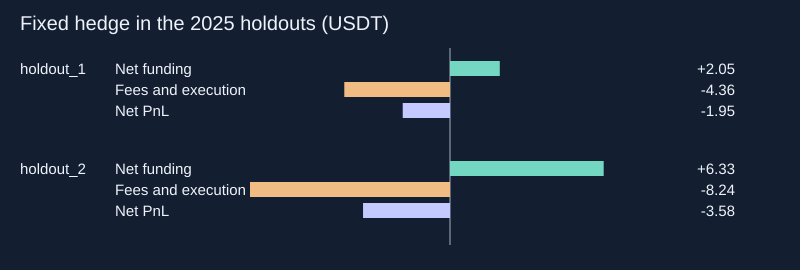

# Profitability and Risk of Delta-Neutral Funding Carry in Cryptocurrency Perpetual Futures: An Out-of-Sample Historical Study

## 1. Abstract

The original two depth-priced regressions earned 119.87 USDT on separate 10,000 USDT allocations. On two frozen 2025 monthly holdouts the fixed 0.5 ETH hedge lost 5.53 USDT in aggregate. Both adaptive rules stayed in cash in these holdouts. The experiment finds funding income in favorable markets and no evidence of a consistently positive out-of-sample risk-adjusted return.

## 2. Introduction

A long spot holding offsets the directional exposure of a linear perpetual short of equal size. The short still faces the funding calendar, changes in the futures premium, separate collateral requirements and execution risk. These cash flows can exceed the small income earned from holding the hedge. [Interactive figures](index.html)

## 3. Research Questions

H1 is supported in the original quarters and some additional windows. H2 is supported by the selected adverse month. H3 has a qualified result. Abstention avoided losses in both holdouts and missed the positive development and validation months. H4 is supported by the zero-funding and break-even accounting below. H5 is supported by simulated liquidations under thinner collateral. H6 fails as a general proposition. Net outcomes change with the funding and execution assumptions. No probability of future profit is estimated.

## 4. Data Sources and Provenance

The discovery file covers 2020-01 through 2025-12 (72 available monthly ETHUSDT funding archives). Each ZIP was listed in the official bucket and verified against its exchange SHA-256 checksum. Market inputs are separate Binance Spot and USD-M trade klines, USD-M mark-price klines at one minute and actual archive/REST funding rates. Spot timestamps in newer archives use microseconds. Both time units are normalized to UTC. ZIP time grids, OHLC, calendar uniqueness and agreement of REST and archive rates are checked. The legacy regressions additionally use hourly spot closes and Tardis public historical Binance book snapshots. REST snapshots and depth files have separate content hashes. [Source manifest](sources.json) · [Binance Public Data](https://github.com/binance/binance-public-data) · [Binance funding-history specification](https://developers.binance.com/docs/derivatives/usds-margined-futures/market-data/rest-api/Get-Funding-Rate-History) · [USD-M leverage brackets](https://developers.binance.com/docs/derivatives/usds-margined-futures/account/rest-api/Notional-and-Leverage-Brackets)

Where REST supplies markPrice we use it. Otherwise the point is the preceding completed minute mark close. The event export includes source, timestamp, gap in milliseconds, point and range. The conditional envelope spans the causal estimate and the published settlement minute low/high. Negative rates reverse the cash-flow ordering of the price endpoints. Estimates are especially important in 2022, when all selected settlement notionals required proxies. [Settlement ledger](settlements.csv.gz)

## 5. Historical Funding Regimes

Scan every available monthly funding archive through 2025-12. Among complete months ending before 2023-10 choose one negative-sum month with >=3 consecutive negative events, ranked by longest run, lowest sum, then date. Also choose one distinct mixed-sign month closest to 50% negative, then earliest. Limit each diagnostic class to one month, to avoid multiple counting and retrospective portfolio selection. Diagnostics are not holdouts. The fixed development, validation and holdout dates are excluded from diagnostic ranking. The full-month calendar includes its opening midnight settlement, while the monthly strategy starts at 01:00. September 2022 had 67.8% negative settlements, a 25-event negative run, and cumulative rate -1.557%. June 2022 had 46.7% negative and a 9-event run. Cumulative rates sum decimal rates without compounding or notional weighting. The monthly export shows every candidate and its summary statistics. [Regime scan](regimes.csv)

## 6. Strategy Formulation

A opens 0.5 ETH on each leg and holds until scheduled exit unless liquidated. B reviews hourly, uses the last nine settled rates with a one-minute publication delay, and extrapolates their mean for 42 settlements. Entry requires at least 0.5 bp per settlement and expected funding above 115% of modeled round-trip fees, half-spreads and slippage. Exit at a nonpositive mean after 24 hours, 4 USDT cumulative funding expense, or 720 hours. Cooldown is 48 hours. C also requires peak planned initial allocation below 50% of capital and absolute basis within 30 bp. It exits on a 22% maintenance-to-equity ratio, three recent negative rates, an excessive basis or a 15 USDT holding loss. There is no prediction feed or optimizer. Optional policies.B.signals, policies.C.signals and policies.C.risk overrides configure the adaptive rules independently. This study uses the common signal settings. [Frozen configuration](../../../configs/carry_study.json)

## 7. Execution and Transaction Costs

Expanded runs use separate venue trade bars for every policy, including on the regression calendars. The first order works over the decision minute and books at its close. The hedge works over a later minute. Aggressor-side volume and quote turnover form a side VWAP, floored adversely at the all-trade VWAP. We add 0.5 bp half-spread, 2 bp slippage per leg, outward 0.01 USDT tick rounding and 10/5 bp spot/perpetual fees in quote equivalent. Each 0.5 ETH order must satisfy a 0.001 ETH lot, 5 USDT notional and 2% of side volume. An unfilled order waits for another minute. These are modeled filters and fee assumptions. Minute averages cannot identify the actual order book or the queue. A forced cover uses at least the worse of the minute trade and mark highs plus slippage, bypasses participation and pays the liquidation penalty. Exact depth is used in the unchanged benchmark reproduction.

## 8. Portfolio Accounting

Spot cash pays the spot principal and fee. The futures wallet pays fees and includes realized short price PnL and signed funding. Total equity equals spot cash plus ETH at the spot close plus the futures wallet plus open short PnL at the USD-M mark plus any in-transit funds. Open and closed wallets are checked against reference-price attribution at every state transition. Within each unchanged-position interval, the two inventories are marked at each minute close. Transfers debit spendable cash at request and credit the futures wallet only on arrival. With no trade, returns on committed capital and profit factor are undefined. Committed capital is peak earmarked initial futures collateral plus requested transfers and open spot acquisition principal during a traded path. Allocated returns always use the scenario's full initial cash. Daily profit factor divides summed gains by absolute summed losses in successive 24-hour equity observations including the terminal stub.

## 9. Margin and Liquidation Modeling

Base futures collateral is 106% of initial target notional. Leverage scenarios divide that amount by 2, 3 or 5. Other capital starts in spot cash. The model uses 10% initial margin, 1% maintenance and a 0.5% liquidation penalty. Historical account-specific tiers and liquidation prints could not be verified. These configurable approximations apply to the small simulated position only. At every minute high the engine compares futures equity with maintenance plus the penalty reserve. A breach forces a short cover and an emergency spot sale if needed. It can happen before an hourly strategy review. Warnings start at a 50% maintenance/equity ratio, counted once per short. At 25% the strategy can request one 100 USDT transfer with an hour's delay. When a trigger coincides with a breach, liquidation takes priority. Within a settlement minute the model posts funding before testing the adverse high and books normal fills at close. Intraminute ordering remains uncertain.

| Window | Scenario | Policy | Forced closes | Net USDT |
| --- | --- | --- | --- | --- |
| Primary | leverage_5 | A | 1 | -15.321 |
| Primary | delayed_transfer_5x | A | 1 | -15.321 |
| Primary | exact_initial_5x | A | 1 | -15.546 |
| Confirmation | leverage_2 | A | 1 | 24.457 |
| Confirmation | leverage_3 | A | 1 | 14.410 |
| Confirmation | leverage_3 | B | 1 | 17.503 |
| Confirmation | leverage_5 | A | 1 | 2.521 |
| Confirmation | leverage_5 | B | 1 | 6.209 |
| Confirmation | reduced_collateral | A | 1 | 29.717 |
| Confirmation | delayed_transfer_5x | A | 1 | 2.521 |
| Confirmation | delayed_transfer_5x | B | 1 | 6.209 |
| Confirmation | exact_initial_2x | A | 1 | 6.618 |
| Confirmation | exact_initial_3x | A | 1 | -4.965 |
| Confirmation | exact_initial_3x | B | 1 | 2.213 |
| Confirmation | exact_initial_5x | A | 1 | 7.937 |
| Confirmation | exact_initial_5x | B | 1 | -3.467 |

## 10. Experimental Design

Development was June 2023, validation July 2024, and the two chronological holdouts March and October 2025. The same configuration ran once across these dates with no return-based parameter selection. The two prior quarters are regression benchmarks. The 2022 months were selected retrospectively on funding and characterize risk, so they cannot estimate unconditional returns. The date range is exclusive at the end. Each monthly sample starts at 01:00 UTC and closes out near month end. For the expanded quarter simulations the scheduled exit decision is 15 minutes before the last modeled minute to accommodate the stressed leg delay. Each run starts with fresh capital.

| Window | Start UTC | End UTC (exclusive) | Negative / all | Observed marks | A | B | C |
| --- | --- | --- | --- | --- | --- | --- | --- |
| negative | 2022-09-01T01:00 | 2022-10-01T00:00 | 60 / 89 | 0 | -13.186 | 0.000 | 0.000 |
| mixed | 2022-06-01T01:00 | 2022-07-01T00:00 | 42 / 89 | 0 | -5.341 | 0.000 | 0.000 |
| development | 2023-06-01T01:00 | 2023-07-01T00:00 | 11 / 89 | 0 | 1.371 | 0.000 | 0.000 |
| validation | 2024-07-01T01:00 | 2024-08-01T00:00 | 0 / 92 | 92 | 3.521 | 0.000 | 0.000 |
| holdout_1 | 2025-03-01T01:00 | 2025-04-01T00:00 | 28 / 92 | 92 | -1.948 | 0.000 | 0.000 |
| holdout_2 | 2025-10-01T01:00 | 2025-11-01T00:00 | 16 / 92 | 92 | -3.584 | 0.000 | 0.000 |
| Primary | 2023-10-01T12:00 | 2024-01-01T11:56 | 0 / 276 | 187 | 32.213 | 23.238 | 23.238 |
| Confirmation | 2024-01-01T12:00 | 2024-04-01T11:56 | 0 / 273 | 273 | 89.255 | 73.946 | 73.946 |

## 11. Baseline Results

The separate depth-based reproduction yielded 32.1580 and 87.7125 USDT. The A column above shows the same calendar evaluated under the common minute execution model and collateral assumptions. The depth replay scheduled its exit at 11:55 UTC. The common minute model scheduled its exit at 11:40 UTC, used side-volume trade prices on successive minutes and charged the opening spot fee in quote currency. Using the prior completed mark for missing settlement prices changed the first quarter's funding by about 0.0014 USDT. Neither fixed-policy base case required a transfer or liquidation. All 549 original payments benefited the short. 460 marks were observed and 89 estimated. Removing all funding gives -11.45 USDT. [Independent audit and complete reconciliation](../audit.md)

## 12. Negative-Funding Regime Results

Across the eight nonoverlapping replay windows there were 157 distinct negative settlements. The adverse window included 60 negative settlements and A earned -12.59 USDT net funding. Its total net was -13.19. B and C took no position in that window. In the mixed month the fixed hedge collected slightly positive net funding but incurred an overall loss. The time-varying ETH notional and the skipped opening settlement can change the sign relative to a full-month unweighted rate sum.

## 13. Funding-Aware Strategy Results

B's entry hurdle often kept the strategy in cash. It missed two positive fixed-policy months and avoided two losing holdouts. Its activity in the two favorable legacy quarters provides an in-sample comparison only. Repeated round trips raised expenses there.

## 14. Risk-Controlled Strategy Results

C matched B's base-case results across these windows. Its incremental controls showed no independent improvement on the frozen evaluation. The worst base-case minute-close portfolio drawdown was 63.80 USDT. PnL divided by maximum drawdown describes each realized path. Flat paths have no defined ratio. Charts include hourly observations and the minute of each policy’s largest drawdown. The minute-high margin ratio uses maintenance divided by adverse futures equity, and minimum margin buffer is futures equity above maintenance at that high. [Full risk and performance metrics](metrics.csv)

| Window | Policy | drawdown | pnl_to_drawdown | max_margin_ratio | min_margin_buffer | warnings | liquidations | holding_hours |
| --- | --- | --- | --- | --- | --- | --- | --- | --- |
| negative | A | 17.859 | -0.738 | 0.013 | 693.270 | 0 | 0 | 718.750 |
| negative | B | 0.000 | — | 0.000 | — | 0 | 0 | 0.000 |
| negative | C | 0.000 | — | 0.000 | — | 0 | 0 | 0.000 |
| mixed | A | 7.528 | -0.710 | 0.010 | 1,014.348 | 0 | 0 | 718.733 |
| mixed | B | 0.000 | — | 0.000 | — | 0 | 0 | 0.000 |
| mixed | C | 0.000 | — | 0.000 | — | 0 | 0 | 0.000 |
| development | A | 5.700 | 0.241 | 0.010 | 947.770 | 0 | 0 | 718.733 |
| development | B | 0.000 | — | 0.000 | — | 0 | 0 | 0.000 |
| development | C | 0.000 | — | 0.000 | — | 0 | 0 | 0.000 |
| validation | A | 9.898 | 0.356 | 0.010 | 1,753.203 | 0 | 0 | 742.733 |
| validation | B | 0.000 | — | 0.000 | — | 0 | 0 | 0.000 |
| validation | C | 0.000 | — | 0.000 | — | 0 | 0 | 0.000 |
| holdout_1 | A | 9.041 | -0.215 | 0.013 | 993.432 | 0 | 0 | 742.733 |
| holdout_1 | B | 0.000 | — | 0.000 | — | 0 | 0 | 0.000 |
| holdout_1 | C | 0.000 | — | 0.000 | — | 0 | 0 | 0.000 |
| holdout_2 | A | 63.804 | -0.056 | 0.013 | 1,869.572 | 0 | 0 | 742.733 |
| holdout_2 | B | 0.000 | — | 0.000 | — | 0 | 0 | 0.000 |
| holdout_2 | C | 0.000 | — | 0.000 | — | 0 | 0 | 0.000 |
| Primary | A | 7.096 | 4.540 | 0.022 | 533.806 | 0 | 0 | 2,207.667 |
| Primary | B | 6.414 | 3.623 | 0.016 | 740.754 | 0 | 0 | 1,307.667 |
| Primary | C | 6.414 | 3.623 | 0.016 | 740.754 | 0 | 0 | 1,307.667 |
| Confirmation | A | 19.664 | 4.539 | 0.053 | 368.026 | 0 | 0 | 2,183.667 |
| Confirmation | B | 19.664 | 3.761 | 0.032 | 626.536 | 0 | 0 | 1,770.667 |
| Confirmation | C | 19.664 | 3.761 | 0.032 | 626.536 | 0 | 0 | 1,770.667 |

## 15. PnL Attribution

Each row below reconciles as spot reference PnL + futures reference PnL + net funding − total cost. Basis and legging split the sum of the two price terms. Basis uses the futures VWAP synchronized to the spot fill minute, while legging captures the change to the later futures reference, including the reverse sequence in liquidation. These are explanatory subdivisions. Funding paid and costs are shown as positive expenses. Zero-funding removes cash flows on the identical realized trading path. With forced liquidations, that counterfactual does not re-simulate margin decisions.

| Window | Policy | spot_pnl | futures_pnl | basis_pnl | legging | funding_received | funding_paid | estimated_funding | total_cost | zero_funding | net |
| --- | --- | --- | --- | --- | --- | --- | --- | --- | --- | --- | --- |
| negative | A | -111.923 | 114.312 | 0.266 | 2.124 | 0.822 | 13.409 | -12.587 | 2.988 | -0.599 | -13.186 |
| negative | B | 0.000 | 0.000 | 0.000 | 0.000 | 0.000 | 0.000 | 0.000 | 0.000 | 0.000 | 0.000 |
| negative | C | 0.000 | 0.000 | 0.000 | 0.000 | 0.000 | 0.000 | 0.000 | 0.000 | 0.000 | 0.000 |
| mixed | A | -461.060 | 458.482 | 0.088 | -2.667 | 2.423 | 2.151 | 0.272 | 3.035 | -5.613 | -5.341 |
| mixed | B | 0.000 | 0.000 | 0.000 | 0.000 | 0.000 | 0.000 | 0.000 | 0.000 | 0.000 | 0.000 |
| mixed | C | 0.000 | 0.000 | 0.000 | 0.000 | 0.000 | 0.000 | 0.000 | 0.000 | 0.000 | 0.000 |
| development | A | 31.784 | -30.625 | -0.073 | 1.232 | 4.392 | 0.330 | 4.062 | 3.850 | -2.691 | 1.371 |
| development | B | 0.000 | 0.000 | 0.000 | 0.000 | 0.000 | 0.000 | 0.000 | 0.000 | 0.000 | 0.000 |
| development | C | 0.000 | 0.000 | 0.000 | 0.000 | 0.000 | 0.000 | 0.000 | 0.000 | 0.000 | 0.000 |
| validation | A | -106.529 | 105.752 | 0.254 | -1.031 | 11.058 | 0.000 | 0.000 | 6.760 | -7.537 | 3.521 |
| validation | B | 0.000 | 0.000 | 0.000 | 0.000 | 0.000 | 0.000 | 0.000 | 0.000 | 0.000 | 0.000 |
| validation | C | 0.000 | 0.000 | 0.000 | 0.000 | 0.000 | 0.000 | 0.000 | 0.000 | 0.000 | 0.000 |
| holdout_1 | A | -195.426 | 195.783 | 0.013 | 0.343 | 2.579 | 0.527 | 0.000 | 4.356 | -4.000 | -1.948 |
| holdout_1 | B | 0.000 | 0.000 | 0.000 | 0.000 | 0.000 | 0.000 | 0.000 | 0.000 | 0.000 | 0.000 |
| holdout_1 | C | 0.000 | 0.000 | 0.000 | 0.000 | 0.000 | 0.000 | 0.000 | 0.000 | 0.000 | 0.000 |
| holdout_2 | A | -145.200 | 143.525 | -0.125 | -1.551 | 7.423 | 1.089 | 0.000 | 8.243 | -9.918 | -3.584 |
| holdout_2 | B | 0.000 | 0.000 | 0.000 | 0.000 | 0.000 | 0.000 | 0.000 | 0.000 | 0.000 | 0.000 |
| holdout_2 | C | 0.000 | 0.000 | 0.000 | 0.000 | 0.000 | 0.000 | 0.000 | 0.000 | 0.000 | 0.000 |
| Primary | A | 306.082 | -307.623 | -1.606 | 0.066 | 37.825 | 0.000 | 4.605 | 4.072 | -5.613 | 32.213 |
| Primary | B | 93.166 | -91.443 | 0.401 | 1.322 | 30.373 | 0.000 | 0.000 | 8.858 | -7.135 | 23.238 |
| Primary | C | 93.166 | -91.443 | 0.401 | 1.322 | 30.373 | 0.000 | 0.000 | 8.858 | -7.135 | 23.238 |
| Confirmation | A | 618.060 | -616.442 | -0.125 | 1.743 | 93.500 | 0.000 | 0.000 | 5.864 | -4.245 | 89.255 |
| Confirmation | B | 433.887 | -427.898 | 0.985 | 5.004 | 86.164 | 0.000 | 0.000 | 18.207 | -12.218 | 73.946 |
| Confirmation | C | 433.887 | -427.898 | 0.985 | 5.004 | 86.164 | 0.000 | 0.000 | 18.207 | -12.218 | 73.946 |

In the two holdouts A received 10.00, paid 1.62 in funding and incurred 12.60 USDT in execution and fees. The break-even gross receipt is total costs minus the two price PnLs plus funding paid. Gross funding exceeding commissions alone is insufficient.

On fixed-policy paths with missing marks, the following figures separate the effect of eliminating estimated payments from the smaller effect of repricing each payment within its conditional envelope. The remaining windows have observed settlement marks for every payment.

| Window (fixed policy) | Estimated events | PnL excluding estimated payments | Lower net | Causal net | Upper net |
| --- | --- | --- | --- | --- | --- |
| negative | 89 | -0.599 | -13.191 | -13.186 | -13.142 |
| mixed | 89 | -5.613 | -5.345 | -5.341 | -5.336 |
| development | 89 | -2.691 | 1.369 | 1.371 | 1.372 |
| Primary | 89 | 27.608 | 32.211 | 32.213 | 32.214 |

## 16. Robustness and Sensitivity

All scenarios rerun both decisions and wallets. Cost-sensitive hurdles can change positions. Receipt haircuts are hypothetical and preserve the actual signed funding signals and all debits. Margin rises to 5% in the higher-maintenance case. Reduced capital uses 3,000 USDT, reduced collateral uses 55% of the base reserve, slow hedging uses five minutes, and the closing stress quadruples additional closing slippage. Delayed transfers take 24 hours. Each row below shows the non-compounded sum of the two holdouts; the losing count covers all eight windows and three policies. The delayed 5x transfer scenario combines two stresses explicitly. The four additional exact-initial-exposure rows remove the 6% collateral reserve to test the literal 1x, 2x, 3x and 5x requested starting ratios. They are supplemental diagnostics and did not change any trading rule. [Supplemental margin settings](../../../configs/carry_margin_stress.json) [Every scenario and break-even point](metrics.csv) · [Sensitivity heatmap](index.html#plot9)

| Scenario | OOS A | OOS B | OOS C | Losing runs / 24 | Simulated liquidations |
| --- | --- | --- | --- | --- | --- |
| base | -5.532 | 0.000 | 0.000 | 4 | 0 |
| double_fees | -14.564 | 0.000 | 0.000 | 6 | 0 |
| triple_fees | -23.597 | 0.000 | 0.000 | 6 | 0 |
| double_slip | -7.932 | 0.000 | 0.000 | 4 | 0 |
| triple_slip | -10.347 | 0.000 | 0.000 | 5 | 0 |
| half_receipts | -10.533 | 0.000 | 0.000 | 6 | 0 |
| quarter_receipts | -13.033 | 0.000 | 0.000 | 6 | 0 |
| higher_margin | -5.532 | 0.000 | 0.000 | 4 | 0 |
| reduced_capital | -1.948 | 0.000 | 0.000 | 3 | 0 |
| delayed_hedge | 1.963 | 0.000 | 0.000 | 2 | 0 |
| expensive_exit | -8.936 | 0.000 | 0.000 | 4 | 0 |
| lower_mark | -5.532 | 0.000 | 0.000 | 4 | 0 |
| upper_mark | -5.532 | 0.000 | 0.000 | 4 | 0 |
| leverage_2 | -5.532 | 0.000 | 0.000 | 4 | 1 |
| leverage_3 | -5.532 | 0.000 | 0.000 | 4 | 2 |
| leverage_5 | -5.532 | 0.000 | 0.000 | 6 | 3 |
| reduced_collateral | -5.532 | 0.000 | 0.000 | 4 | 1 |
| delayed_transfer | -5.532 | 0.000 | 0.000 | 4 | 0 |
| delayed_transfer_5x | -5.532 | 0.000 | 0.000 | 6 | 3 |
| exact_initial_1x | -5.532 | 0.000 | 0.000 | 4 | 0 |
| exact_initial_2x | -5.532 | 0.000 | 0.000 | 4 | 1 |
| exact_initial_3x | -5.532 | 0.000 | 0.000 | 5 | 2 |
| exact_initial_5x | -5.532 | 0.000 | 0.000 | 7 | 3 |

## 17. Limitations

Two holdout months on one instrument offer little statistical power. The diagnostic months deliberately overrepresent adverse regimes. Fees, trade-bar executions, side-volume limits, collateral timing and liquidation are simulations. There is no yield on free cash, spot financing, clawback, liquidation queue, ADL, tax, venue default, market impact beyond the specified model or counterparty model. Using every minute close still misses intraminute portfolio drawdown. Public settlement marks are missing for early periods. Envelope endpoints use later observations for valuation sensitivity only. A stressed wallet rerun can change subsequent risk decisions; these envelope scenarios are retrospective sensitivities. The conditional bounds do not certify an unpublished exchange mark. No annualized Sharpe or statistical claim of alpha is warranted.

## 18. Conclusion

Positive funding supported the original two quarters. The frozen fixed policy lost money in both new holdouts. Avoiding exposure improved those outcomes but produced no positive holdout return. The holdout PnLs depend on fill prices estimated from one-minute trades. Those bars cannot establish the price or size available when each leg would have traded. Thinner futures collateral triggered simulated liquidations despite the matching spot position. The counts depend on assumed margin tiers and penalties and on testing each minute's high. Historical account-specific rules, intraminute ordering and liquidation fills could not be verified.

## 19. Reproducibility

From the repository root, install the pinned research environment and the editable package, then run `python scripts/reproduce_funding_carry.py`. Historical inputs are cached in `data/funding-carry`. The command verifies exchange checksums or saved content hashes, reproduces both original windows, runs the 552 policy/window/scenario combinations, audits the wallets and settlements, and writes the offline figures and tables. The run used 168.0 MiB of unique source files. Machine-specific runtime and library versions are in [study.json](study.json). [Input hashes](input_hashes.json) · [Funding](settlements.csv.gz) · [Fills](fills.csv.gz) · [Wallets](balances.csv.gz) · [Decisions](decisions.csv.gz) · [Hourly curves](curves.csv.gz) · [Stress events](risk_events.csv.gz)
