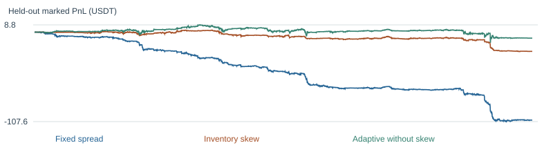

# Does Inventory-Aware Market Making Improve Risk-Adjusted Performance in Cryptocurrency Markets?

## 1. Abstract

In a held-out replay of ETHUSDT perpetual futures from 2023-09-04 through 2023-09-06 UTC, net PnL after maker fees was -105.84 USDT for fixed quotes, -23.11 USDT for adaptive quotes with skew, and -7.17 USDT for the identical adaptive widths without skew. Binance returned 15 funding rates with empty settlement marks. Funding is excluded. These are simulated marked outcomes on real exchange messages.

## 2. Research question

Does moving the reservation price against accumulated inventory improve marked PnL per unit of exposure? The fixed-to-adaptive comparison changes both width and skew. The adaptive ablation keeps the width rule identical and removes only the reservation-price shift.

## 3. Data and quality checks

The replay consumes 5,448,909 individual trade prints and 24,325,079 top-of-book updates from 2023-09-02 through 2023-09-06. Each source passed archive size and SHA-256 checks, schema checks, monotonic time and ID checks, price/size checks, UTC coverage and interday continuity checks. The two feeds overlap on every day. Equal timestamps preserve sequence within each stream. The archive contains 121 raw trade-ID jumps. Each was corroborated against a separately checksummed sequence of consecutive aggregate prints. Only raw trades provide fill volume.

| UTC day | Trades | Book updates | Max trade gap · s | Max book gap · s |
| --- | --- | --- | --- | --- |
| 2023-09-02 | 779308 | 4191912 | 12.647 | 3.637 |
| 2023-09-03 | 794257 | 4061042 | 22.241 | 4.205 |
| 2023-09-04 | 1049704 | 4757278 | 12.557 | 2.77 |
| 2023-09-05 | 1320230 | 5645418 | 13.908 | 2.481 |
| 2023-09-06 | 1505410 | 5669429 | 15.209 | 2.218 |

The [dataset manifest](quality.json) records the actual file URLs, hashes, repeated timestamps, minute-level event-rate percentiles, unmatched day edges, contract snapshot and funding responses. Trades use transaction time. Strategies and marks see book updates only after their archived publication time. Exchange post-only checks use the matching-engine transaction clock. One cannot recover client receipt order from this replay. [Binance archive documentation](https://github.com/binance/binance-public-data)

## 4. Market microstructure assumptions

A passive buy requires a sell-initiated print below its price. A passive sell requires a buy-initiated print above its price. The print pays the resting limit price in the simulation. Each strategy independently consumes at most 10% of any eligible historical print, rounded down to tradable lots. Each side has at most one outstanding order. Historical orders and trade prices do not respond to our quotes.

## 5. Strategy formulations

The baseline quotes mid ± mid × 3.0 / 20,000. At refreshes we calculate realized log variance from trailing squared log returns divided by elapsed seconds. Multiplication by current mid squared gives price variance rate v, in (USDT/ETH)²/s. The adaptive reservation price is mid − γ q v H. Signed inventory q is in ETH, H in seconds, and γ in inverse USDT. Its half-width is mid × (half-spread bp + fee bp) / 10,000 + a √(v H) + γ Q v H / 2, where Q is the nominal order size. This simplified rule combines a fee allowance, volatility cushion and inventory-risk term. The no-skew policy sets the reservation price to mid and retains every width term.

## 6. Event-driven simulation methodology

Funding and exchange-side expiry precede trades on a timestamp tie. Individual prints see the last strictly earlier book. After the prints, acknowledgements and quote decisions see the last book through that time. Activation at the same millisecond as a print cannot earn a fill on that print. An indexed L1 stream provides the same last visible state as stepping through every quote update between decision points. Drawdown revalues held inventory at every book update, including intermediate updates at tied timestamps.

New orders take 50 ms to activate and cancellation takes 80 ms. An order awaiting cancellation remains exposed. Replacements wait for acknowledgement and a subsequent scheduled decision. Exchange-local lifetime is 15000 ms from activation. Books older than 2000 ms suppress fills and new quotes. A stale decision requests cancellation and resets volatility history.

## 7. Execution and queue limitations

Strict trade-through is an eligibility proxy. Aggregate L1 size gives no identity, hidden depth, full queue or matching-engine priority. Quantity changes alone never produce fills. The optional at-price model starts behind the entire displayed touch at activation and credits only matching prints against that queue. Unknown depth receives no at-price allocation. Neither queue approximation nor no-fill mode contributes to the reported default strategy results.

## 8. Transaction costs and inventory accounting

All policies start flat with 10,000 USDT collateral. Each fill pays the configured 1.0 bp maker fee. The fully collateralized research position limit of 0.5 ETH makes peak position notional small relative to starting capital over this sample. There is no leverage multiplier in PnL. Binance returned 15 funding rates with empty settlement marks. Funding is excluded. Exchange liquidation, mark-price margin mechanics and forced terminal liquidation are outside this replay.

The linear futures wallet equals initial collateral + average-cost realized PnL − fees + funding. Equity adds unrealized PnL marked to the observed L1 mid. Independently, equivalent financing cash equals initial capital minus signed execution notionals and fees plus funding. Equity equals that cash plus inventory times the mark. Residuals below compare both formulas in USDT.

| Policy | Financing cash | Position · ETH | Final equity | Realized gross | Unrealized | Fees | Funding applied | Residual · USDT |
| --- | --- | --- | --- | --- | --- | --- | --- | --- |
| Fixed spread | 9,840.298 | 0.033 | 9,894.1647 | -51.4107 | -0.0022 | 54.4225 | 0 | 1.56e-11 |
| Inventory skew | 9,973.6256 | 0.002 | 9,976.8903 | -16.8004 | -0.0019 | 6.3074 | 0 | -3.80e-13 |
| Adaptive without skew | 9,976.5054 | 0.01 | 9,992.8286 | -1.7981 | -0.0093 | 5.364 | 0 | -3.50e-12 |

## 9. Experimental setup

Calibration covered 2023-09-02 through the UTC day before 2023-09-04. Its default net PnLs were -36.81 USDT (fixed), -2.56 (skew) and +0.19 (ablation). Evaluation began flat with a fresh estimator at 2023-09-04 00:00 UTC. Positions and active orders carried across days within each phase. Defaults were specified before computing performance. No parameter was selected by optimizing the holdout.

The common order size was 0.1 ETH, refresh 5000 ms, position cap 0.5 ETH, and spread floor 3.0 bp full width. Adaptive parameters were γ = 0.8, H = 60 s, a = 0.35 and variance lookback 180 s. Tick, lot, order size, static price and notional filters use a retrieved contract snapshot. Historical filter changes and the exchange’s dynamic mark-relative band cannot be fully reconstructed from L1.

## 10. Results

| Evaluation metric | Fixed spread | Inventory skew | Adaptive without skew |
| --- | --- | --- | --- |
| Net PnL · USDT | -105.8353 | -23.1097 | -7.1714 |
| Gross trading PnL · USDT | -51.4128 | -16.8023 | -1.8074 |
| Maker fees · USDT | 54.4225 | 6.3074 | 5.364 |
| Return · % | -1.0584 | -0.2311 | -0.0717 |
| Fills | 16,277 | 1,586 | 1,281 |
| Submitted orders with a fill · % | 10.5377 | 1.1199 | 1.0086 |
| Submitted quantity filled · % | 9.9266 | 1.0947 | 0.9772 |
| Traded notional · USDT | 544,224.5216 | 63,074.4117 | 53,640.0133 |
| Time-average \|inventory\| · ETH | 0.2749 | 0.1962 | 0.2441 |
| Maximum \|inventory\| · ETH | 0.5 | 0.5 | 0.5 |
| Inventory utilization · % | 54.9748 | 39.2366 | 48.82 |
| Maximum drawdown · USDT | 107.8734 | 25.8831 | 30.5267 |
| PnL / RMS inventory · USDT per ETH | -335.0807 | -94.5121 | -25.0192 |
| Immediate capture · USDT | 20.023 | 6.5578 | 6.046 |
| Realized before fees · USDT | -51.4107 | -16.8004 | -1.7981 |
| Terminal unrealized · USDT | -0.0022 | -0.0019 | -0.0093 |
| Terminal inventory · ETH | 0.033 | 0.002 | 0.01 |
| 1s directional markout · USDT | -61.6194 | -8.3412 | -8.4714 |
| 5s directional markout · USDT | -67.3052 | -9.721 | -9.9131 |
| 30s directional markout · USDT | -67.6104 | -11.346 | -15.3597 |
| 60s directional markout · USDT | -70.3732 | -12.2488 | -16.2124 |

Net PnL includes terminal unrealized value. Fill rate counts distinct submitted orders receiving at least one execution. Inventory averages and RMS use time integrals between fills. Utilization divides mean absolute inventory by the configured cap. The risk ratio divides net PnL by RMS inventory in ETH and is undefined for a flat strategy. It is sensitive to turnover and sample length.

Daily price returns and ranges use one-minute observed mids. Daily PnL uses consecutive UTC closing equity.

| UTC session | Mid return · % | Mid range / open · % | Fixed spread · USDT | Inventory skew · USDT | Adaptive without skew · USDT |
| --- | --- | --- | --- | --- | --- |
| 2023-09-04 | -0.3113 | 1.4347 | -31.5125 | 1.5044 | 8.5918 |
| 2023-09-05 | 0.2178 | 2.2005 | -35.2479 | -8.7354 | -6.794 |
| 2023-09-06 | -0.0802 | 2.9584 | -39.0749 | -15.8787 | -8.9691 |

## 11. Adverse-selection analysis

Immediate capture compares the execution price with the strictly prior midpoint. Directional markout values signed movement from that mid to the most recent valid mid at or before the horizon. Combined values add capture. Fee-adjusted values deduct the execution fee once. Cash amounts below are sums in USDT over the valid subset at each horizon. Side-specific bp values normalize by that side’s valid executed notional. Out-of-sample and stale marks are missing. These overlapping diagnostics have a different accounting horizon from ledger PnL.

At one second, directional movement totaled -61.6194 USDT for the fixed maker and -8.3412 USDT for the inventory-skewed maker. Including execution-price advantage and the maker fee gives -96.0189 and -8.0909 USDT respectively for the same sets of fills.

| Policy | s | Valid | Missing | Capture | Directional | Combined | After fee | Buy dir. bp | Sell dir. bp |
| --- | --- | --- | --- | --- | --- | --- | --- | --- | --- |
| Fixed spread | 1 | 16277 | 0 | 20.023 | -61.6194 | -41.5964 | -96.0189 | -1.0839 | -1.1806 |
| Fixed spread | 5 | 16277 | 0 | 20.023 | -67.3052 | -47.2822 | -101.7047 | -1.2322 | -1.2412 |
| Fixed spread | 30 | 16277 | 0 | 20.023 | -67.6104 | -47.5874 | -102.0099 | -0.9701 | -1.5146 |
| Fixed spread | 60 | 16277 | 0 | 20.023 | -70.3732 | -50.3502 | -104.7727 | -0.9952 | -1.5911 |
| Inventory skew | 1 | 1586 | 0 | 6.5578 | -8.3412 | -1.7834 | -8.0909 | -1.3625 | -1.2823 |
| Inventory skew | 5 | 1586 | 0 | 6.5578 | -9.721 | -3.1632 | -9.4707 | -1.6028 | -1.4796 |
| Inventory skew | 30 | 1586 | 0 | 6.5578 | -11.346 | -4.7882 | -11.0956 | -2.0018 | -1.5957 |
| Inventory skew | 60 | 1586 | 0 | 6.5578 | -12.2488 | -5.691 | -11.9984 | -2.0357 | -1.8482 |
| Adaptive without skew | 1 | 1281 | 0 | 6.046 | -8.4714 | -2.4255 | -7.7895 | -1.3932 | -1.7655 |
| Adaptive without skew | 5 | 1281 | 0 | 6.046 | -9.9131 | -3.8671 | -9.2311 | -1.2055 | -2.491 |
| Adaptive without skew | 30 | 1281 | 0 | 6.046 | -15.3597 | -9.3137 | -14.6777 | -1.9816 | -3.746 |
| Adaptive without skew | 60 | 1281 | 0 | 6.046 | -16.2124 | -10.1665 | -15.5305 | -2.0734 | -3.9721 |

## 12. Sensitivity analysis

Each scenario changes one setting at a time and replays all 3 held-out days from flat, carrying inventory between days. The reference row repeats the main evaluation. A fee change affects the adaptive width rule as well as realized costs. Of 34 policy–scenario combinations, 34 lost money. Zero-fee net PnL was -51.41 USDT for fixed quoting and -27.48 USDT for the adaptive policy. Cells marked n/a refer to parameters unused by the baseline.

| Parameter | Value | Fixed · USDT | Skew · USDT |
| --- | --- | --- | --- |
| reference | default | -105.8353 | -23.1097 |
| gamma | 0.2 | n/a | -26.6973 |
| gamma | 2.0 | n/a | -18.9451 |
| spread_bps | 1.0 | -301.3793 | -42.6001 |
| spread_bps | 6.0 | -35.4487 | -23.7765 |
| inventory_limit | 0.2 | -88.7432 | -17.568 |
| inventory_limit | 1.0 | -110.8452 | -24.9041 |
| new_latency_ms | 10 | -105.1721 | -22.2499 |
| new_latency_ms | 250 | -100.618 | -22.4587 |
| cancel_latency_ms | 20 | -105.893 | -20.3251 |
| cancel_latency_ms | 400 | -114.5329 | -21.2493 |
| maker_fee_bps | 0.0 | -51.4128 | -27.4759 |
| maker_fee_bps | 2.0 | -160.2577 | -23.7709 |
| participation | 0.02 | -101.7284 | -20.8038 |
| participation | 0.25 | -108.6756 | -21.9444 |
| vol_window_s | 60 | n/a | -25.8586 |
| vol_window_s | 600 | n/a | -18.8008 |
| refresh_ms | 1000 | -106.2949 | -9.9194 |
| refresh_ms | 10000 | -109.2038 | -8.3202 |

The paired adaptive-minus-fixed evaluation PnL difference was +82.73 USDT. Resampling 12 aligned six-hour PnL increments in 5,000 bootstrap replicates gave a descriptive 95% percentile interval of [46.79, 121.25] USDT for the evaluation-period total. Adjacent blocks share inventory and regimes. The interval is conditional on these paths and the chosen block length.

## 13. Discussion

Adaptive quoting changed turnover from 544,225 to 63,074 USDT and fees from 54.42 to 6.31 USDT. Its shift component contributed a paired PnL difference of -15.94 USDT relative to identical adaptive widths with zero skew. Mean absolute position was 0.196 ETH with skew and 0.244 ETH without it. Lower inventory exposure and higher PnL are distinct empirical questions.

## 14. Limitations

The 5 observed UTC days and one instrument provide little evidence about persistent performance across regimes. The publication timestamp can lag exchange transactions. Measured transport delay, own market impact, queue cancellations, rebates by account tier, margin liquidation and terminal unwind costs would change a deployment study. Multi-day regime-stratified holdouts, recorded receive timestamps and exchange acknowledgements would make stronger follow-up tests.

## 15. Conclusion

3 of the 3 evaluated policies lost money after the assumed maker fee. The observed fixed-to-skew difference combines a width change with inventory control. The more direct test of skew is its -15.94 USDT difference against the adaptive ablation. This sample cannot establish a durable trading edge.

[Interactive research report](index.html) · [Machine-readable evaluation metrics](evaluation.json) · [Scenario results](sensitivity.json)
